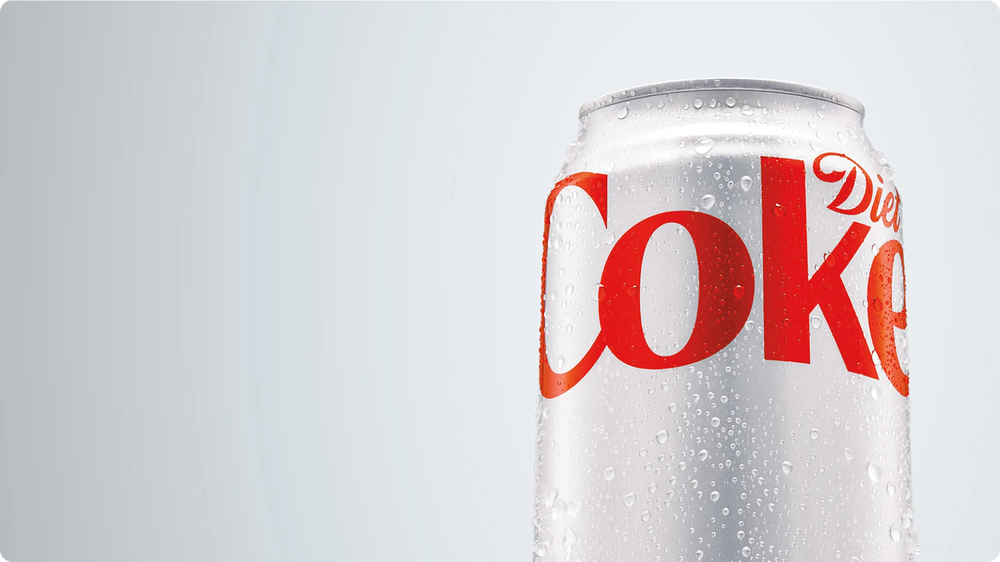

# Diet Coke 3D Interactive Experience

A bespoke, high-performance 3D web experience inspired by Diet Coke ([diet-coke-inspired-experience.vercel.app](https://diet-coke-inspired-experience.vercel.app/)).

Built with **Three.js**, **GSAP (ScrollTrigger)**, **Lenis**, and **Vite**.



## ✨ Features

- **Procedural 3D Can**: Built with Three.js primitives (`CylinderGeometry`, `TorusGeometry`, `SphereGeometry`), realistic brushed aluminum `MeshStandardMaterial`, beveled rims, and an articulated pull-tab.
- **Dynamic 2D Canvas Label**: Generates a 2048x2048 brushed metal texture on an offscreen canvas with authentic typography and procedural condensation water droplets.
- **Apple-Style Scroll Scrubbing**: Pinned 3D Hero stage driven by GSAP ScrollTrigger scrubbing rotation, bobbing, and watermark parallax.
- **Interactive 3D Pour Simulation**: Second pinned stage featuring a lathe-geometry highball glass, animated pull-tab popping open, flowing 3D cola tube stream, rising amber fluid, frothy foam disc, and 28 ascending carbonation bubbles.
- **Lenis Smooth Scrolling**: Cinema-grade buttery scrolling synchronized with GSAP's animation ticker.
- **Scroll & Haptic Feedback**: Mobile vibration effects (`navigator.vibrate`) paired with pulsing edge visual feedback.
- **Editorial Brand Showcase**: Milestone heritage timeline (1982 to Today), parallax break banner, moments photography grid, and interactive 3-flavor lineup cards.
- **Accessibility & Reduced Motion**: Complete detection of `prefers-reduced-motion` with an interactive on-screen toggle and persistent user preference.
- **15-Step Complete Guide**: Contains `guide.html` and `GUIDE.md` featuring 15 structured prompts, explanations, and copy buttons modeled after Apple-style scroll architecture guides.

## 🚀 Getting Started

### Prerequisites

- Node.js (v18 or higher recommended)
- npm or pnpm

### Installation

```bash
# Clone the repository
git clone https://github.com/yashpstanwar/diet-coke-inspired-experience.git
cd diet-coke-inspired-experience

# Install dependencies
npm install

# Start local development server
npm run dev
```

### Production Build

```bash
# Build optimized production bundle
npm run build

# Preview production build locally
npm run preview
```

## 📖 15-Step Prompt Guide

Open `guide.html` in your browser to view the interactive 15-step prompt guide with one-click copy buttons and technical explanations.

## 🛠️ Tech Stack

- **3D Engine**: Three.js
- **Animation & Scrubbing**: GSAP & ScrollTrigger
- **Smooth Scroll**: Lenis
- **Bundler**: Vite
- **Typography**: DM Sans & Oswald (Google Fonts)

## 📄 License

MIT. Created as an unofficial creative brand experience. Diet Coke is a registered trademark of The Coca-Cola Company.
